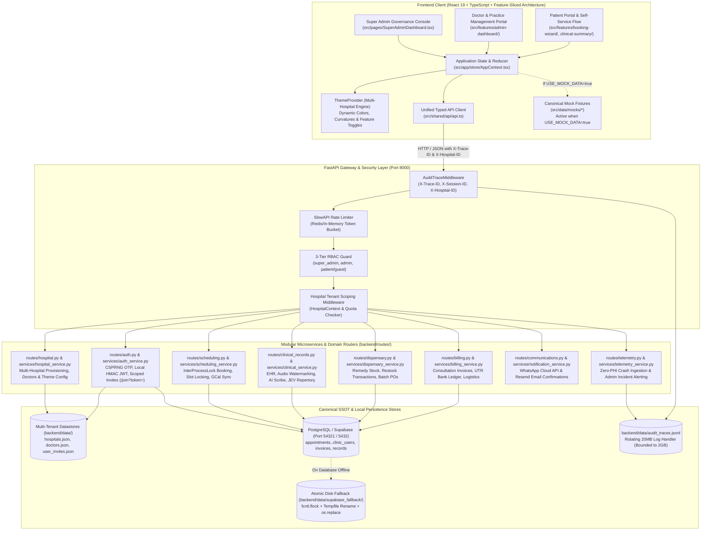

# System Architecture: Enterprise Multi-Hospital Healthcare & EHR Platform (Homo_project)

## 1. Architectural Philosophy & Multi-Hospital Tenancy Core

The platform is engineered as an **Enterprise Multi-Hospital / Multi-Tenant Healthcare & Electronic Health Records (EHR) Operating System**. Rather than being bound to a single clinical entity, the core architecture is designed from the ground up to support multiple hospital organizations, medical centers, and outpatient clinics simultaneously.

> [!NOTE]
> **Onboarded Hospital Tenants**:  
> **Agastya Classical Homeopathy** (`agastya`) is one of the premier onboarded hospital tenants provided as a production reference instance, alongside the default base template (**General Healthcare Hospital**, `default`) and enterprise network tenants (e.g., **Apollo TeleHealth & Integrated Clinics**, `apollo`). Additional hospitals are provisioned on-demand via the Super Admin Console without code modifications or server restarts.

The architecture is founded upon five core pillars:

1. **Dynamic Multi-Hospital Tenancy (Dual-Resolution Engine)**:
   - **Option A (Domain / Subdomain Resolution)**: Resolves the active hospital tenant via the incoming request hostname (e.g. `agastya.homoeo.org`, `apollo.clinic.net`, or `localhost?tenant=agastya`).
   - **Option B (Auth JWT & Header Resolution)**: Authenticated requests carry tenant context via signed JWT claims and the `X-Hospital-ID` request header.
   - **Dynamic Branding & Feature SSOT**: Each hospital maintains its own visual theme (colors, typography, logo, card curvature), contact details, courier logistics, and toggleable feature switches (`enableECommerce`, `enableVoiceStudio`, `enablePrescriptionScan`, `enableOnlinePayments`).

2. **Strict HIPAA Multi-Hospital PHI Isolation**:
   - Complete partition wall: every clinical record, appointment, invoice, visit summary, prescription, and audio recording is strictly scoped to a canonical `hospital_id`.
   - A clinician or patient with accounts across multiple institutions **can never** view or leak Protected Health Information (PHI) across hospital boundaries unless an explicit cross-hospital referral release is executed.
   - Any cross-tenant or unauthorized access attempt returns `403 Forbidden` and emits an automated, tamper-evident security alert.

3. **Super-Admin Governance & Quotas**:
   - 3-Tier governance model separating cross-hospital Super Admins (`super_admin`), Clinic Directors / Doctors (`admin`), and Patients (`patient`/`guest`).
   - Super Admins provision new hospitals (`POST /api/v1/hospitals`), configure quotas (`MAX_CUSTOMERS_PER_HOSPITAL = 1000`, `MAX_ADMINS = 10`), toggle global developer modes, and audit platform telemetry.

4. **Single Source of Truth (SSOT) with Zero-Data-Loss Fallback**:
   - PostgreSQL (hosted on-premise or via Supabase) serves as canonical persistence for clinical, billing, inventory, and scheduling data.
   - Dual-layer cache with `InterProcessLock` (`fcntl.flock` + `threading.Lock`) and atomic disk writes ensures that even during database maintenance or network drops, on-premise clinics suffer zero data loss and automatically reconcile when connectivity resumes.

5. **Vertical Slice & Feature-Sliced Architecture**:
   - **Backend**: Thin FastAPI routers mapped to isolated vertical domain services (`routes/hospital.py`, `routes/scheduling.py`, `routes/clinical_records.py`, `routes/billing.py`, etc.).
   - **Frontend**: Feature-Sliced Architecture (FSD) organizing code into strictly-enforced layers (`src/app/`, `src/pages/`, `src/features/`, `src/entities/`, `src/shared/`).

---

## 2. Universal System Architecture Diagram



---

## 3. Multi-Hospital Tenancy & PHI Isolation Model

### 3.1 Tenant Data Separation

Every primary persistence structure enforces a `hospital_id` foreign key partition:

```sql
-- Appointments strictly partitioned by hospital tenant
ALTER TABLE public.appointments ADD COLUMN IF NOT EXISTS hospital_id TEXT NOT NULL DEFAULT 'default';
CREATE INDEX IF NOT EXISTS idx_appointments_hospital ON public.appointments(hospital_id, status);

-- Unique slot booking enforced per hospital to prevent inter-clinic collision
CREATE UNIQUE INDEX IF NOT EXISTS idx_appointments_slot_unique 
ON public.appointments (hospital_id, start_time, doctor_title) 
WHERE status != 'cancelled';
```

### 3.2 Tenant Isolation Wall in Application Layer

In `backend/core/security.py`, `scope_items_to_patient_or_admin` ensures callers can only access records matching their verified tenant:

```python
def scope_items_to_patient_or_admin(
    items: list[dict],
    current_user: dict | None,
    patient_key: str = "patient_id",
    hospital_key: str = "hospital_id"
) -> list[dict]:
    """
    Guarantees strict two-dimensional isolation:
    1. Tenant Isolation: Users can only view data scoped to their authorized hospital_id.
    2. PHI Isolation: Patients can only view records where patient_id matches their identity.
    """
```

### 3.3 Dynamic Onboarding & Reference Tenants

| Tenant ID | Hospital Name | Domain / Subdomain | Specialty Focus |
|---|---|---|---|
| `default` | **General Healthcare Hospital** | `localhost` / `default` | Standard multi-specialty baseline template |
| `agastya` | **Agastya Classical Homeopathy Hospital** | `agastya.*` / `agastyahomoeo.com` | Constitutional homeopathy, miasmatic repertory, JEV engine |
| `apollo` | **Apollo TeleHealth & Integrated Clinics** | `apollo.*` / `telehealth.care` | Distributed multi-doctor teleconsultation network |
| `custom-*` | **On-Demand Provisioned Hospital** | Provisioned via `POST /api/v1/hospitals` | Instant dynamic onboarding via Super Admin GUI |

---

## 4. High-Concurrency Design (≥100 Concurrent Users)

### Problem Statement
Under peak patient surges (e.g. morning registration windows), simultaneous write operations on slot bookings, inventory decrements, and invoice numbering can induce race conditions, thread starvation, and double-bookings.

### Concurrency Protection Stack

1. **Layer 1: Partial Unique Composite Constraint (Database Level)**:
   ```sql
   CREATE UNIQUE INDEX IF NOT EXISTS idx_appointments_slot_unique 
   ON public.appointments (hospital_id, start_time, doctor_title) 
   WHERE status != 'cancelled';
   ```
   Enforces mathematical serialization. If 50 patients attempt to claim `2026-11-20 09:30 AM` under Doctor A at Hospital X, exactly 1 succeeds (`201 Created`); the remaining 49 receive clean `409 Conflict` responses without data corruption.

2. **Layer 2: Dual-Layer InterProcessLock (OS Kernel Level)**:
   Defined in `backend/services/data_store.py`:
   - Combines in-process `threading.Lock` (thread safety) with kernel-level `fcntl.flock(LOCK_EX)` (process safety across multiple Uvicorn workers).
   - Atomic replacement (`tempfile.NamedTemporaryFile` + `os.replace` + `os.fsync`) prevents dirty reads or half-written records.
   - High-throughput in-memory TTL read cache (3.0s window) absorbs read storms without disk thrashing.

3. **Layer 3: Frontend Adaptive Polling**:
   - Adaptive 15-second background synchronization combined with immediate focus revalidation (`window.addEventListener("focus")`).
   - Slashes client-to-server request volume from 400 req/s down to <10 req/s under 100 concurrent browser sessions.

---

## 5. Security & Multi-Tier Role-Based Access Control (RBAC)

### 3-Tier Governance Hierarchy

| Role | Scope | Permitted Endpoints & Capabilities |
|---|---|---|
| `super_admin` | Platform Global | Provisions new hospitals (`POST /api/v1/hospitals`), configures global quotas, manages multi-hospital doctors, toggles dev/live mode, audits cross-hospital security logs. |
| `admin` | Hospital Scoped | Hospital Director / Doctor. Manages local practice doctors (`POST /api/v1/doctors`), sends user invites (`POST /api/v1/auth/invite`), reviews full clinical case records, manages inventory, approves prescriptions. |
| `patient` / `guest` | Self Scoped | Consumer portal. Self-registers or accepts invite links (`/join?token=...`) scoped strictly to assigned hospital. Manages own appointments, views sanitized personal summaries, pays invoices. |

### Security Endpoints & Protections

- **CSPRNG OTP Engine**: 6-digit one-time passcodes generated exclusively via `secrets.randbelow(900000) + 100000`.
- **Zero Hardcoded Backdoors**: Strict constant-time validation (`hmac.compare_digest`) with a 5-attempt rate-limiting lockout and 10-minute expiration.
- **HMAC-SHA256 JWT**: Zero external auth provider dependency; tokens signed locally with secret verification and persistent JTI revocation checking (`/auth/logout`).
- **Bounded Forensic Audit Trail**: Global `AuditTraceMiddleware` tags every HTTP request with `X-Trace-ID`, `X-Session-ID`, and `X-Hospital-ID`. Written to `audit_traces.jsonl` using a 20MB rotating file handler capped at 100 rotations (bounded to 2GB disk footprint max).
- **HTTP Connection Pool**: Shared `httpx.AsyncClient` pool in `backend/shared/http_pool.py` prevents TCP socket exhaustion under external API and Supabase PostgREST load.

---

*Cross-reference: [`WIRING_AND_DATA_FLOW.md`](./WIRING_AND_DATA_FLOW.md) · [`MULTI_HOSPITAL_DESIGN_SYSTEM_PLAN.md`](./MULTI_HOSPITAL_DESIGN_SYSTEM_PLAN.md) · [`RUN_AND_TEST_GUIDE.md`](./RUN_AND_TEST_GUIDE.md) · [`DEVELOPER_CHEATSHEET.md`](./DEVELOPER_CHEATSHEET.md)*
