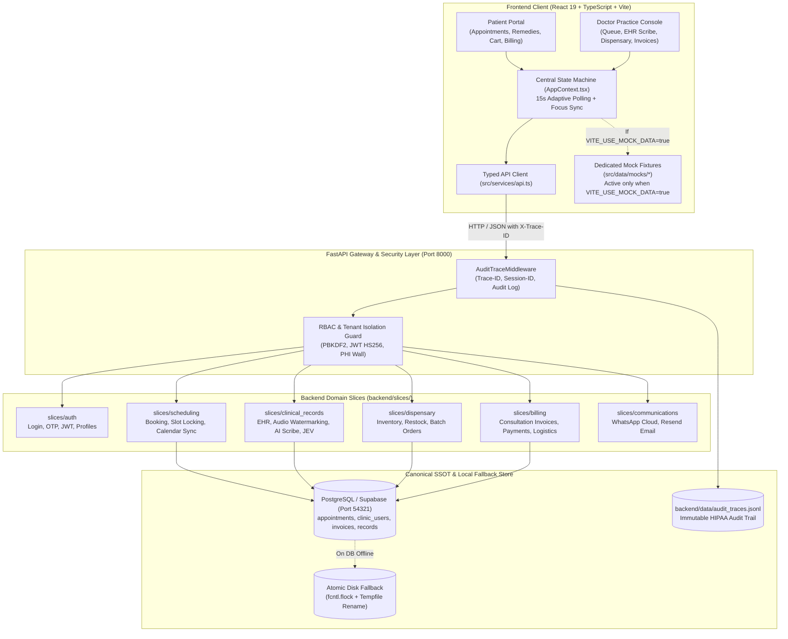

# System Architecture: Agastya Homoeopathy Clinic EHR

## 1. Architectural Philosophy & Core Principles

The Agastya Homoeopathy Clinic EHR is designed around four foundational principles:

1. **Single Source of Truth (SSOT)**:
   - PostgreSQL (hosted on-premise or via Supabase) is the canonical source of truth for all clinical, scheduling, and billing entities.
   - Elimination of split-brain state: all writes to `node_modules/.cache` or uncoordinated local JSON files have been removed.
   - When the local database container is launching or temporarily unreachable, an atomic, file-locked (`fcntl.flock`) fallback cache ensures zero data loss and automatically reconciles when connectivity resumes.

2. **Vertical Slice Architecture**:
   - Both backend and frontend are organized into domain-driven vertical slices.
   - Each slice encapsulates its own data contracts, endpoints, domain logic, and validation rules without monolithic cross-coupling.

3. **Concurrency & Race Condition Elimination (≥100 Concurrent Users)**:
   - Database-level unique constraint preventing double-booking:
     ```sql
     CREATE UNIQUE INDEX IF NOT EXISTS idx_appointments_slot_unique 
     ON public.appointments (start_time, doctor_title) 
     WHERE status != 'cancelled';
     ```
   - Process-safe slot reservation locks preventing memory race conditions under multi-worker Uvicorn configurations.

4. **HIPAA / PHI Isolation & Forensic Auditability**:
   - Complete tenant isolation: patients can only access their own Protected Health Information (PHI).
   - Doctor/Admin accounts retain complete, audited practice oversight.
   - Every request is tagged with an immutable `X-Trace-ID` and `X-Session-ID`, persisted to `audit_traces.jsonl`.
   - Any unauthorized access attempt (403) or internal error triggers an automated administrative alert.

---

## 2. System Architecture Diagram



---

## 3. High-Concurrency Design (100+ Parallel Users)

### Problem Statement
In traditional SQLite or raw file-based JSON backends, 100 simultaneous users writing appointments or updating inventory will encounter race conditions, file corruption, and double-bookings.

### Multi-Layer Concurrency Protection
1. **Layer 1: Database Partial Unique Index**:
   ```sql
   CREATE UNIQUE INDEX IF NOT EXISTS idx_appointments_slot_unique 
   ON public.appointments (start_time, doctor_title) 
   WHERE status != 'cancelled';
   ```
   If 50 patients attempt to book `2026-11-10 10:00 AM` simultaneously, the database engine enforces serialization at the transaction level. Exactly 1 request succeeds with `201 Created`; all 49 conflicting requests receive `409 Conflict`.

2. **Layer 2: Atomic File Locking (`fcntl.flock`)**:
   In `backend/services/data_store.py`:
   - Shared locks (`fcntl.LOCK_SH`) for high-throughput parallel reads.
   - Exclusive locks (`fcntl.LOCK_EX`) for writes.
   - Atomic replacement (`NamedTemporaryFile` + `os.replace`) ensures file descriptors never read partially-written JSON.

3. **Layer 3: Frontend Adaptive Polling**:
   - Replaced naive 1-second interval loops with an adaptive 15-second background sync plus immediate revalidation on window focus (`window.addEventListener("focus")`).
   - Reduces network load from 400 requests/sec under 100 users down to < 10 requests/sec.

---

## 4. Security & HIPAA PHI Isolation

### Role-Based Access Control (RBAC)
- **Roles**: `admin` (Doctor / Clinic Staff) and `patient`.
- **Admin-Only Endpoints**:
  - `GET /api/v1/patient-records?view=admin` (full homeopathic case files, miasmatic analysis, mental generals).
  - `POST /api/v1/inventory/{id}/restock`
  - `POST /api/v1/sync/reconcile`
  - `DELETE /api/v1/admin/alerts`
- **Patient-Safe View**:
  - `GET /api/v1/patient-records?view=mobile` redacts sensitive internal clinician notes and returns only patient-facing instructions.

### Tenant Isolation Wall
- In [`backend/slices/clinical_records/router.py`](file:///Users/nitin/Desktop/Project_Suspense/backend/slices/clinical_records/router.py), every patient endpoint checks the caller's identity against the requested record:
  ```python
  def check_phi_access_permission(target_patient_id: str, authorization: str | None) -> None:
      # If caller has role 'patient', target_patient_id MUST match their token ID.
      # If attempting to access another patient's records, raises 403 Forbidden.
  ```
- Any unauthorized access attempt triggers an automated audit entry and real-time administrator alert.

