# Comprehensive Code & Architecture Review: Customer & Admin Portals
**Agastya Homoeopathy Clinic EHR (Project Suspense)**
*System Version: 2.4.0 • Multi-Tenant Healthcare Architecture • HIPAA & DPDP Compliant*

---

## 1. Executive Summary & Architectural Scope

Project Suspense is engineered as a high-concurrency, dual-portal clinical operating system. The codebase cleanly separates patient-facing healthcare interactions from physician/administrator clinical governance while maintaining a **Single Source of Truth (SSOT)**:

1. **Customer Portal (Patient Facing)**:
   - Self-service appointment scheduling with live doctor availability and conflict prevention.
   - Real-time clinical summary access (*"My Summary"*): consultation history, prescribed homeopathic potencies, and lifestyle advice.
   - Multi-channel consultation fee settlements (UPI QR instant scan, credit/debit cards, 30+ Indian commercial banks) with tax-exempt digital receipts.
   - Dispensary remedy ordering with 3rd-party logistics tracking (BlueDart/Delhivery).
   - Dynamic patient personalization powered by administrator-controlled visibility filters (doctor credentials, AgastyaBot AI assistant, medical records, and profile editing).

2. **Admin / Doctor Portal (Clinical & Practice Management Console)**:
   - Real-time clinical consultation queue, appointment triage, and doctor to-do checklist.
   - Electronic Health Record (EHR) case taking, audio dictation, speech-to-text case analysis, and diagnostic media attachments.
   - Dispensary inventory stock monitoring, batch purchase order generation, and real-time Excel inventory synchronization.
   - Financial audit and banking reconciliation for UPI UTR references.
   - Doctor availability scheduling, multi-day Out-Of-Office (OOO) blocking, and public patient notice configuration.
   - Comprehensive Tenant Customization with passcode-authorized Customer View filters and tamper-evident audit logging.

---

## 2. Universal System Tree Map

```mermaid
graph TD
    ROOT["App Root (src/App.tsx)"]
    
    %% Providers
    THEME_CTX["ThemeProvider (Multi-Tenant & Design Tokens)"]
    APP_CTX["AppProvider / AppContext (SSOT State Machine)"]
    ROOT --> THEME_CTX --> APP_CTX
    
    %% App Shell
    SHELL["AppShell (Layout Frame)"]
    APP_CTX --> SHELL
    
    %% Shell Persistent Overlays
    SHELL --> NAV["NavBar (src/components/layout/NavBar.tsx)"]
    SHELL --> BOTTOM_NAV["BottomNav (src/components/layout/BottomNav.tsx)"]
    SHELL --> CART_DRAWER["CartDrawer (src/components/layout/CartDrawer.tsx)"]
    SHELL --> TRACKING_MODAL["TrackingModal (src/components/modals/TrackingModal.tsx)"]
    SHELL --> ORDERS_MODAL["OrdersModal (src/components/modals/OrdersModal.tsx)"]
    SHELL --> CHATBOT["ChatbotWidget (src/components/widgets/ChatbotWidget.tsx)"]
    SHELL --> AUTH_PANEL["AuthPanel (src/components/layout/AuthPanel.tsx)"]
    SHELL --> FOOTER["PageFooter (src/components/layout/PageFooter.tsx)"]
    
    %% Router
    SHELL --> ROUTER["PageRouter (Dynamic Page Switch)"]
    
    %% Customer Portal Branch
    subgraph CustomerPortal["1. Customer Portal (Patient Facing)"]
        ROUTER --> HOME["HomePage (/home)"]
        ROUTER --> ABOUT["AboutPage (/about)"]
        ROUTER --> APPT_PAGE["AppointmentsPage (/appointments)"]
        ROUTER --> ORDER_MED["OrderMedicinePage (/order-medicine)"]
        ROUTER --> CART_PAGE["CartPage (/cart-page)"]
        ROUTER --> VISIT_SUM["VisitSummaryPage (/visit-summary)"]
        
        %% Appointments Page Children
        APPT_PAGE --> CAL_PICKER["CalendarPicker (Slot Matrix)"]
        
        %% Medicine & Cart Children
        ORDER_MED --> RX_CAPTURE["PrescriptionCaptureModal (OCR)"]
        CART_PAGE --> RX_CAPTURE
        
        %% Visit Summary Children
        VISIT_SUM --> MODAL_PAY["Settle Consultation Fee Modal (Gateway)"]
        VISIT_SUM --> MODAL_RECEIPT["Digital Tax-Exempt Receipt Modal"]
        VISIT_SUM --> MODAL_JSON["Classical Homeopathy Case JSON Modal"]
        VISIT_SUM --> MODAL_EDIT_PROF["Edit Medical Profile Modal"]
    end
    
    %% Admin Portal Branch
    subgraph AdminPortal["2. Admin & Doctor Portal (/admin-dashboard)"]
        ROUTER --> PROT_GUARD["ProtectedRoute (Role: admin)"]
        PROT_GUARD --> ADMIN_DASH["AdminDashboard (src/pages/AdminDashboard.tsx)"]
        
        ADMIN_DASH --> TAB_OVERVIEW["OverviewTab (Queue & KPIs)"]
        ADMIN_DASH --> TAB_APPTS["AppointmentsTab (Doctor Roster)"]
        ADMIN_DASH --> TAB_PATIENTS["PatientRecordsTab (EHR Clinical Files)"]
        ADMIN_DASH --> TAB_BILLING["BillingInvoicesTab (Fee Collection)"]
        ADMIN_DASH --> TAB_INVENTORY["DispensaryInventoryTab (Stock)"]
        ADMIN_DASH --> TAB_DISPATCHES["DispatchesTab (Logistics POs)"]
        ADMIN_DASH --> TAB_CALENDAR["CalendarTab (Availability & OOO)"]
        ADMIN_DASH --> TAB_CUSTOM["CustomizationTab (Tenant Config)"]
        
        %% Admin Modals
        TAB_APPTS --> MODAL_ADMIN_BOOK["AppointmentBookingModal"]
        TAB_APPTS --> MODAL_ADMIN_CANCEL["AppointmentCancellationModal"]
        
        TAB_PATIENTS --> MODAL_UPLOAD_RX["DoctorPrescriptionUploadModal"]
        TAB_PATIENTS --> MODAL_PRESCRIBE["PrescribeRemedyModal"]
        TAB_PATIENTS --> MODAL_MEDIA_UP["ClinicalMediaUploadModal"]
        TAB_PATIENTS --> MODAL_MEDIA_LIGHT["ClinicalMediaLightboxModal"]
        TAB_PATIENTS --> MODAL_VOICE["AdminVoiceStudioModal"]
        
        TAB_BILLING --> MODAL_POST_FEE["PostConsultationFeeModal"]
        TAB_BILLING --> MODAL_UTR["UtrReconciliationModal"]
        
        TAB_INVENTORY --> MODAL_EXCEL["ExcelSyncModal (SheetJS)"]
        
        TAB_DISPATCHES --> MODAL_CUSTOM_PO["CustomPOModal"]
        TAB_DISPATCHES --> MODAL_BATCH_PO["ConsolidatedBatchOrderModal"]
        TAB_DISPATCHES --> MODAL_TIMELINE["LogisticsTimelineModal"]
        
        TAB_CALENDAR --> MODAL_INSPECT_OOO["Blocked Date Details Modal"]
        
        TAB_CUSTOM --> MODAL_CV_PASS["Save Customer View Passcode Modal"]
        TAB_CUSTOM --> MODAL_CHG_PASS["Change Passcode Modal"]
        TAB_CUSTOM --> MODAL_ADD_PASS["Add Passcode Modal"]
    end
```



---

## 3. High-Level Design (HLD)

### 3.1 Dual-Portal User Journey & Security Architecture

```
┌─────────────────────────────────────────────────────────────────────────────┐
│                       HTTP Client / Web Browser                             │
└───────────────────────┬─────────────────────────────┬───────────────────────┘
                        │                             │
                        ▼                             ▼
        ┌───────────────────────────────┐  ┌─────────────────────────────────┐
        │        Customer Portal        │  │       Admin / Doctor Portal     │
        │        (Role: patient)        │  │          (Role: admin)          │
        ├───────────────────────────────┤  ├─────────────────────────────────┤
        │ • Browse Remedies & Doctor Bio│  │ • ProtectedRoute Gate Guard     │
        │ • Book Real-Time Slots        │  │ • Patient Consultation Queue    │
        │ • View Medical History (PHI)  │  │ • Issue Prescriptions & Remedies│
        │ • Settle Fees via UPI / Cards │  │ • Reconcile Bank Payments       │
        │ • Track Courier Dispatches    │  │ • Passcode Security Controls    │
        └───────────────┬───────────────┘  └────────────────┬────────────────┘
                        │                                   │
                        ▼                                   ▼
        ┌────────────────────────────────────────────────────────────────────┐
        │                 Central State Machine (AppContext)                 │
        │   • SSOT In-Memory Store   • 15s Background Sync   • Action Reducer│
        └─────────────────────────────────┬──────────────────────────────────┘
                                          │
                                          ▼
        ┌────────────────────────────────────────────────────────────────────┐
        │            FastAPI Security & Vertical Slice Gateway               │
        │   • AuditTraceMiddleware (X-Trace-ID) • RBAC Token Verifier        │
        │   • HIPAA PHI Isolation Wall • Concurrency Locking Engine          │
        └────────────────────────────────────────────────────────────────────┘
```

### 3.2 Dynamic Tenant Customization Cascading

A core innovation in the architecture is the **Multi-Tenant Feature Cascading Pipeline**. When an administrator modifies access filters in [`CustomizationTab.tsx`](file:///Users/nitin/Desktop/Project_Suspense/src/pages/admin/CustomizationTab.tsx), changes are verified via admin passcode, stored in the tenant configuration, and automatically reflected in real time across customer screens without requiring full page reloads:

| Feature Flag in `tenant.features` | Admin Controller (`CustomizationTab.tsx`) | Customer Portal Effect |
| :--- | :--- | :--- |
| `displayDoctorDetails` | Switch: *Display Doc Details* | Controls doctor title, registration number, qualifications, and biography on [`HomePage.tsx`](file:///Users/nitin/Desktop/Project_Suspense/src/pages/HomePage.tsx) and [`AboutPage.tsx`](file:///Users/nitin/Desktop/Project_Suspense/src/pages/AboutPage.tsx). When switched OFF, generic clinic physician info is shown. |
| `enableAgastyaBot` | Switch: *AgastyaBot* | Toggles the floating [`ChatbotWidget.tsx`](file:///Users/nitin/Desktop/Project_Suspense/src/components/ChatbotWidget.tsx) AI assistant and automated FAQ drawer across all patient views. |
| `enablePatientProfileEdit` | Switch: *Patient Details Edit Option* | Shows/hides the `"Edit Profile"` button on [`VisitSummaryPage.tsx`](file:///Users/nitin/Desktop/Project_Suspense/src/pages/VisitSummaryPage.tsx). When OFF, the patient record is strictly read-only. |
| `enablePatientMedicalRecords` | Switch: *My Summary: Display Patient Record* | Controls visibility of Tab 1 (*Medical History & Consultation Timeline*) in [`VisitSummaryPage.tsx`](file:///Users/nitin/Desktop/Project_Suspense/src/pages/VisitSummaryPage.tsx). |
| `enableBillingHistory` | Switch: *My Summary: Billing & Payment History* | Controls visibility of Tab 2 (*Consultation Invoices, Payment Gateway, and Tax Receipts*) in [`VisitSummaryPage.tsx`](file:///Users/nitin/Desktop/Project_Suspense/src/pages/VisitSummaryPage.tsx). |
| `enableFollowupFeedback` | Switch: *My Summary: Follow-up & Feedback* | Controls visibility of Tab 3 (*Recovery Progress Questionnaire and Google Review Sync*) in [`VisitSummaryPage.tsx`](file:///Users/nitin/Desktop/Project_Suspense/src/pages/VisitSummaryPage.tsx). |
| `enableECommerce` | Switch: *Dispensary & Medicine Ordering* | Controls visibility of the `/order-medicine` catalogue, cart drawer, and ordering workflows. |
| `enableCustomerPayments` | Switch: *Online Checkout & Settlements* | Enables or disables online payment processing buttons on invoice cards. |

---

## 4. Low-Level Design (LLD): Portal 1 — Customer Portal

### 4.1 Page Components & Hierarchies

#### 1. Home Page (`src/pages/HomePage.tsx`)
- **Parent**: `PageRouter` inside `AppShell`.
- **Purpose**: Brand showcase, doctor credentials display, clinical specialties overview, and primary booking CTA.
- **Child Components**:
  - Doctor Credentials Hero Card: Dynamically renders `tenant.doctor.name`, `tenant.doctor.regNo`, and qualifications if `tenant.features.displayDoctorDetails !== false`.
  - Specialties Grid: Chronic allergies, skin ailments, digestive disorders, pediatric constitutional health.
  - Verified Patient Testimonials: Real reviews curated from clinic patient experiences.

#### 2. Appointments Page (`src/pages/AppointmentsPage.tsx`)
- **Parent**: `PageRouter`.
- **Key Modules**:
  - [`CalendarPicker.tsx`](file:///Users/nitin/Desktop/Project_Suspense/src/components/CalendarPicker.tsx): Renders live calendar days. Blocks days in real time based on `state.blockedDates` (e.g. holidays, doctor conferences) with visual Out-of-Office tooltips.
  - Slot Matrix: Generates 25 slots across Morning (09:00 AM – 01:00 PM) and Evening (05:00 PM – 09:00 PM). Automatically disables booked or locked slots.
  - Booking Drawer: Collects patient name, WhatsApp phone number, and chief complaint. Validates phone number and checks for slot conflicts via `api.bookAppointment`.

#### 3. Medical Records Portal ("My Summary") (`src/pages/VisitSummaryPage.tsx`)
- **Parent**: `PageRouter`.
- **Protected State**: Displays clinical records for `state.authUser`. In Demo Mode, defaults to registered patient profile `usr-001` (Aarav Patel).
- **Sub-Tabs**:
  1. **Tab 1: Medical History & Records** (`enablePatientMedicalRecords`):
     - Displays chronological consultation cards (`VisitSummaryRecord`).
     - Chief diagnosis, observed symptoms, doctor assessment notes, and lifestyle guidance.
     - Prescribed Remedies Table: Medicine name, potency (e.g. `30C`, `200CH`), administration dosage, and duration.
     - **Modal**: Certified Classical Homeopathy Record JSON Modal. Displays privacy-filtered case JSON mapped to classical homeopathy schema.
  2. **Tab 2: Billing & Payment History** (`enableBillingHistory`):
     - Outstanding Consultation Invoices Banner.
     - **Modal**: Settle Consultation Fee (`payingInvoice`). Supports UPI QR instant transfer (with direct VPA `@oksbi`, `@ybl`, `@paytm`), Credit/Debit Card validation, and NetBanking dropdown (30+ Indian commercial banks).
     - **Modal**: Official Healthcare Tax-Exempt Receipt Modal (`viewingReceiptInvoice`). Renders HSN/SAC code 999312 under Notification No. 12/2017-Central Tax (Rate) with print/save PDF support.
  3. **Tab 3: Follow-up & Feedback** (`enableFollowupFeedback`):
     - Dynamic questionnaire for symptom progress evaluation.
     - Direct Google Review sync: Copies review text to clipboard and launches clinic Google Maps review intent.
- **Profile Header**:
  - Patient demographics (Age, Gender, Blood Group, Emergency Contact, Allergies, History).
  - **Modal**: Edit Patient Medical Profile (`isEditPatientModalOpen`). Updates personal information directly via `dispatch({ type: "UPDATE_PATIENT_PROFILE" })`.

#### 4. Medicine Catalogue & Cart (`src/pages/OrderMedicinePage.tsx` & `src/pages/CartPage.tsx`)
- **Remedy Catalogue**: Explores `MEDICINE_CATALOGUE` with dynamic potencies (`30C`, `200CH`, `1M`, `Q Mother Tincture`, `6X Biochemic`).
- **Modal**: [`PrescriptionCaptureModal.tsx`](file:///Users/nitin/Desktop/Project_Suspense/src/components/PrescriptionCaptureModal.tsx): Live webcam camera capture and local file drop. Simulates OCR text extraction of remedies and potencies.
- **Cart Checkout**: Address entry with automatic pincode validation, courier dispatch estimate, and order placement.

---

## 5. Low-Level Design (LLD): Portal 2 — Admin / Doctor Portal

### 5.1 Master Controller (`src/pages/AdminDashboard.tsx`)
- **Security Check**: Executes `useRequireRole("admin")`. Automatically throws an `RbacAccessError` and redirects unauthorized users.
- **State Integration**: Subscribes to `visitSummaries`, `inventory`, `adminTab`, `blockedDates`, `appointments`, and `consultationInvoices` from `useApp()`.
- **Sub-Tab Navigation**:
  1. `OverviewTab`: Queue, KPIs, and doctor to-do list.
  2. `AppointmentsTab`: Practice schedule management.
  3. `PatientRecordsTab`: Clinical EHR files and media.
  4. `BillingInvoicesTab`: Financial oversight.
  5. `DispensaryInventoryTab`: Remedy inventory.
  6. `DispatchesTab`: Wholesale orders.
  7. `CalendarTab`: Doctor availability.
  8. `CustomizationTab`: Practice settings.

---

### 5.2 Tab-by-Tab Breakdown & Dedicated Modals

#### 1. Overview Tab (`src/pages/admin/OverviewTab.tsx`)
- **KPI Metrics**: Total registered patients, active appointments today, low-stock dispensary alerts, pending uncollected fees.
- **Active Consultation Queue**: Real-time list of waiting patients with quick-action shortcuts (*"Start Consultation"*, *"Prescribe Remedy"*, *"Post Fee"*).
- **Doctor To-Do Checklist**: Real-time interactive todo list (`DEFAULT_DOCTOR_TODOS`) with toggle, delete, and add item capabilities.

#### 2. Appointments Tab (`src/pages/admin/AppointmentsTab.tsx`)
- **Roster Controls**: Filter by date range, branch, doctor, or status (`confirmed`, `in-progress`, `completed`, `cancelled`).
- **Modal**: [`AppointmentBookingModal.tsx`](file:///Users/nitin/Desktop/Project_Suspense/src/pages/admin/modals/AppointmentBookingModal.tsx):
  - Form ID: `form="appointment-booking-form"`.
  - Sticky footer with action buttons.
  - Allows booking directly into the doctor's calendar on behalf of walk-in clinic patients.
- **Modal**: [`AppointmentCancellationModal.tsx`](file:///Users/nitin/Desktop/Project_Suspense/src/pages/admin/modals/AppointmentCancellationModal.tsx):
  - Confirms slot release, reasons for cancellation, and triggers automatic WhatsApp patient notification.

#### 3. Patient Records Tab (`src/pages/admin/PatientRecordsTab.tsx`)
- **Clinical EHR Drawer**: Displays searchable list of all registered patients. Expanding a patient displays their complete consultation dossier.
- **Modal**: [`DoctorPrescriptionUploadModal.tsx`](file:///Users/nitin/Desktop/Project_Suspense/src/pages/admin/modals/DoctorPrescriptionUploadModal.tsx):
  - Form ID: `form="doctor-prescription-form"`.
  - Multi-row remedy prescription editor (Remedy name, potency, dosage, and duration).
  - Diagnostic observations, chief complaints, and lifestyle guidance.
  - Pinned sticky action footer.
- **Modal**: [`PrescribeRemedyModal.tsx`](file:///Users/nitin/Desktop/Project_Suspense/src/pages/admin/modals/PrescribeRemedyModal.tsx):
  - Fast-action single remedy allocation directly from dispensary catalogue.
- **Modal**: [`ClinicalMediaUploadModal.tsx`](file:///Users/nitin/Desktop/Project_Suspense/src/pages/admin/modals/ClinicalMediaUploadModal.tsx):
  - Uploads diagnostic tongue photos, dermatology rash images, lab pathology reports, and audio dictation files.
- **Modal**: [`ClinicalMediaLightboxModal.tsx`](file:///Users/nitin/Desktop/Project_Suspense/src/pages/admin/modals/ClinicalMediaLightboxModal.tsx):
  - Encrypted high-resolution viewing lightbox with variable-speed audio player (1x, 1.25x, 1.5x) and download copy actions.
- **Modal**: [`AdminVoiceStudioModal.tsx`](file:///Users/nitin/Desktop/Project_Suspense/src/components/AdminVoiceStudioModal.tsx):
  - Doctor audio case dictation studio with live waveform visualizer, audio recorder, and speech-to-text case analysis.

#### 4. Billing & Invoices Tab (`src/pages/admin/BillingInvoicesTab.tsx`)
- **Consultation Ledger**: Itemizes all clinic invoices, visit types, settlement statuses, and payment modes.
- **Modal**: [`PostConsultationFeeModal.tsx`](file:///Users/nitin/Desktop/Project_Suspense/src/pages/admin/modals/PostConsultationFeeModal.tsx):
  - Quick pills for common consultation amounts (₹500, ₹750, ₹1000, ₹1500).
  - Supports initial status as *"Awaiting Online Payment"* (shows on patient portal) or *"Paid at Clinic Desk (Cash)"*.
  - Sticky footer with `form="post-fee-form"`.
- **Modal**: [`UtrReconciliationModal.tsx`](file:///Users/nitin/Desktop/Project_Suspense/src/pages/admin/modals/UtrReconciliationModal.tsx):
  - Bank transaction reconciliation. Allows administrators to verify 12-digit UPI UTR numbers against bank statements and unlock official digital tax receipts.

#### 5. Dispensary & Inventory Tab (`src/pages/admin/DispensaryInventoryTab.tsx`)
- **Inventory Matrix**: Real-time tracking of medicine quantities, low-stock thresholds, and distributor details.
- **Quick Restock Drawer**: Instantly increments stock quantities and syncs with backend database.
- **Modal**: [`ExcelSyncModal.tsx`](file:///Users/nitin/Desktop/Project_Suspense/src/pages/admin/modals/ExcelSyncModal.tsx):
  - Powered by SheetJS (`xlsx`). Enables bidirectional sync: exports dispensary stock to `.xlsx` and parses imported supplier spreadsheets with discrepancy diff preview.

#### 6. Logistics & Dispatches Tab (`src/pages/admin/DispatchesTab.tsx`)
- **Order Pipeline**: Manages wholesale pharmacy purchase orders and patient remedy dispatches.
- **Modal**: [`CustomPOModal.tsx`](file:///Users/nitin/Desktop/Project_Suspense/src/pages/admin/modals/CustomPOModal.tsx):
  - Creates manual distributor orders for out-of-stock potencies (Reckeweg, SBL, Schwabe).
- **Modal**: [`ConsolidatedBatchOrderModal.tsx`](file:///Users/nitin/Desktop/Project_Suspense/src/pages/admin/modals/ConsolidatedBatchOrderModal.tsx):
  - Consolidates multiple patient prescriptions into one wholesale batch purchase order dispatched via WhatsApp/Email.
- **Modal**: [`LogisticsTimelineModal.tsx`](file:///Users/nitin/Desktop/Project_Suspense/src/pages/admin/modals/LogisticsTimelineModal.tsx):
  - Real-time courier checkpoint tracker (BlueDart Express AWB scanning).

#### 7. Calendar & Doctor Availability Tab (`src/pages/admin/CalendarTab.tsx`)
- **Schedule Management**: Full interactive month/year availability calendar.
- **Out-of-Office (OOO) Blocking**:
  - Single-date or multi-date range blocking.
  - Custom public notice configuration (e.g. *"Doctor attending International Homeopathy Seminar in London"*).
- **Modal**: Inspect Blocked Schedule Details & Patient Notice. Allows updating or deleting blocked entries with live unblock actions.

#### 8. Tenant Customization Tab (`src/pages/admin/CustomizationTab.tsx`)
- **Architecture**: Multi-card modular layout where **each configuration group has its own dedicated Save & Apply button**:
  1. **Customer View Customization**:
     - Checkbox controls for 6 customer features.
     - Action: `🔒 Save & Apply Customer View Settings`.
     - Opens the **Passcode Confirmation Modal** (`isCustomerViewSaveModalOpen`) to authorize broadcast to patient portal.
  2. **General Clinic & Platform Modules**:
     - Action: `💾 Save & Apply Platform Modules`.
  3. **Hospital & Clinic Information**:
     - Action: `💾 Save & Apply Clinic Information`.
  4. **Doctor Profile & Bio**:
     - Action: `💾 Save & Apply Doctor Profile`.
  5. **Branding, Media, Logo & Banner**:
     - Action: `💾 Save & Apply Branding Settings`.
  6. **Security Passcodes & Audit Trail**:
     - Modals for *Change Master Passcode* and *Add New Passcode*.
     - Forensic audit trail table logging all administrative actions.
  7. **Factory Reset Utility Bar**:
     - Action: `↺ Reset Tenant to Factory Defaults` (restores clinic factory settings with confirmation).

---

## 6. Shared Architecture & UI Engineering Standards

### 6.1 Viewport Clamping & Modal Architecture ([`Modal.tsx`](file:///Users/nitin/Desktop/Project_Suspense/src/components/ui/Modal.tsx))

To completely prevent popups from hanging, blurring without opening, or getting cut off on mobile/small laptops, all modals adhere to a standardized layout:

```
┌────────────────────────────────────────────────────────────────────────┐
│  Browser Viewport (100dvh)                                             │
│                                                                        │
│  ┌──────────────────────────────────────────────────────────────────┐  │
│  │ Persistent Top Header / Clinic Navbar (z-[60], 56px - 64px)       │  │
│  └──────────────────────────────────────────────────────────────────┘  │
│                                                                        │
│    Clearance Gap: pt-16 sm:pt-20 (Header remains completely visible)   │
│                                                                        │
│    ┌──────────────────────────────────────────────────────────────┐    │
│    │ Centered Card Panel (max-h-[calc(100dvh-5rem)])               │    │
│    │                                                              │    │
│    │  [1] Sticky Header (shrink-0): Title & Close Button          │    │
│    │  ──────────────────────────────────────────────────────────  │    │
│    │  [2] Scrollable Body (flex-1 min-h-0 overflow-y-auto):       │    │
│    │      • All inputs, tables, images, tabs scroll here          │    │
│    │  ──────────────────────────────────────────────────────────  │    │
│    │  [3] Sticky Footer (shrink-0): Action & Submit Buttons       │    │
│    └──────────────────────────────────────────────────────────────┘    │
│                                                                        │
│    Clearance Gap: pb-16 sm:pb-8 (Footer remains completely visible)    │
│                                                                        │
│  ┌──────────────────────────────────────────────────────────────────┐  │
│  │ Persistent Bottom Navigation Bar (z-[60], 56px)                  │  │
│  └──────────────────────────────────────────────────────────────────┘  │
└────────────────────────────────────────────────────────────────────────┘
```

#### The 4 Engineering Principles:
1. **Root Portal Attachment**:
   All modals execute `createPortal(modalContent, document.body)`. This guarantees popups are never trapped inside ancestor containers with CSS `transform`, `filter`, or animations.
2. **Dynamic Viewport Unit (`100dvh`)**:
   Uses `100dvh` rather than `100vh` so mobile address bars or DevTools resizing immediately adapt without clipping.
3. **3-Tier Flexbox Box Clamping**:
   - Card: `flex flex-col overflow-hidden`
   - Header: `shrink-0` (never compressed)
   - Body: `flex-1 min-h-0 overflow-y-auto custom-scrollbar`
   - Footer: `shrink-0` (always pinned and accessible)
4. **HTML5 Form Decoupling**:
   Form action buttons reside in the sticky footer using the HTML5 `form="..."` attribute:
   ```tsx
   <Modal footer={<Button type="submit" form="booking-form">Confirm</Button>}>
     <form id="booking-form" onSubmit={handleSubmit}>
       {/* Scrollable inputs */}
     </form>
   </Modal>
   ```

---

## 7. File & Code Mapping Matrix

| Domain Feature | Portal | Main File Path | Child Components & Modals | State Store / Context | Backend Route / Service |
| :--- | :--- | :--- | :--- | :--- | :--- |
| **Home & Branding** | Customer | `src/pages/HomePage.tsx` | `NavBar.tsx`, `PageFooter.tsx` | `ThemeProvider`, `AppContext` | `routes/auth` |
| **Appointments Booking** | Customer | `src/pages/AppointmentsPage.tsx` | `CalendarPicker.tsx`, `PhoneInput.tsx` | `AppContext.appointments` | `routes/scheduling` |
| **Customer Medical Records** | Customer | `src/pages/VisitSummaryPage.tsx` | Fee Gateway Modal, Tax Receipt Modal, Case JSON Modal, Edit Profile Modal | `AppContext.visitSummaries`, `consultationInvoices` | `routes/clinical_records`, `routes/billing` |
| **Remedy Catalogue** | Customer | `src/pages/OrderMedicinePage.tsx` | `PrescriptionCaptureModal.tsx`, `CartDrawer.tsx` | `AppContext.cart` | `routes/dispensary` |
| **Logistics Tracking** | Customer | `src/components/TrackingModal.tsx` | `OrdersModal.tsx` | `AppContext.orders` | `routes/dispensary` |
| **AgastyaBot AI** | Customer | `src/components/ChatbotWidget.tsx` | Floating chat bubble, quick replies | `ThemeProvider.tenant.features` | `routes/communications` |
| **Admin Overview & Queue** | Admin | `src/pages/admin/OverviewTab.tsx` | KPI cards, Todo checklist | `AppContext` | `routes/clinical_records` |
| **Admin Appointments** | Admin | `src/pages/admin/AppointmentsTab.tsx` | `AppointmentBookingModal.tsx`, `AppointmentCancellationModal.tsx` | `AppContext.appointments` | `routes/scheduling` |
| **Clinical Records & EHR** | Admin | `src/pages/admin/PatientRecordsTab.tsx` | `DoctorPrescriptionUploadModal.tsx`, `PrescribeRemedyModal.tsx`, `ClinicalMediaUploadModal.tsx`, `ClinicalMediaLightboxModal.tsx`, `AdminVoiceStudioModal.tsx` | `AppContext.visitSummaries` | `routes/clinical_records` |
| **Billing & Reconciliation** | Admin | `src/pages/admin/BillingInvoicesTab.tsx` | `PostConsultationFeeModal.tsx`, `UtrReconciliationModal.tsx` | `AppContext.consultationInvoices` | `routes/billing` |
| **Dispensary Stock & Excel** | Admin | `src/pages/admin/DispensaryInventoryTab.tsx`| `ExcelSyncModal.tsx` | `AppContext.inventory` | `routes/dispensary` |
| **Dispatches & POs** | Admin | `src/pages/admin/DispatchesTab.tsx` | `CustomPOModal.tsx`, `ConsolidatedBatchOrderModal.tsx`, `LogisticsTimelineModal.tsx` | In-memory purchase orders & requisitions | `routes/dispensary` |
| **Calendar & OOO** | Admin | `src/pages/admin/CalendarTab.tsx` | Block Date Inspection Modal | `AppContext.blockedDates` | `routes/scheduling` |
| **Tenant Customization** | Admin | `src/pages/admin/CustomizationTab.tsx` | Passcode Confirmation Modal, Change Passcode Modal, Add Passcode Modal | `ThemeProvider.updateTenant`, `auditLogs` | `routes/auth` |

---

## 8. Verification & Test Suite Summary

- **Production Build**: `npm run build` completed with **0 TypeScript and 0 Rollup errors**.
- **Frontend Test Suite**: `npx vitest run` passed **40 / 40 test suites** covering UI primitives, tenant resolution, and state machine transitions.
- **Backend Test Suite**: `./test/run_tests.sh` passed **74 / 74 tests** covering API contracts, HIPAA PHI tenant isolation, PBKDF2 authentication, and appointment concurrency serialization.

