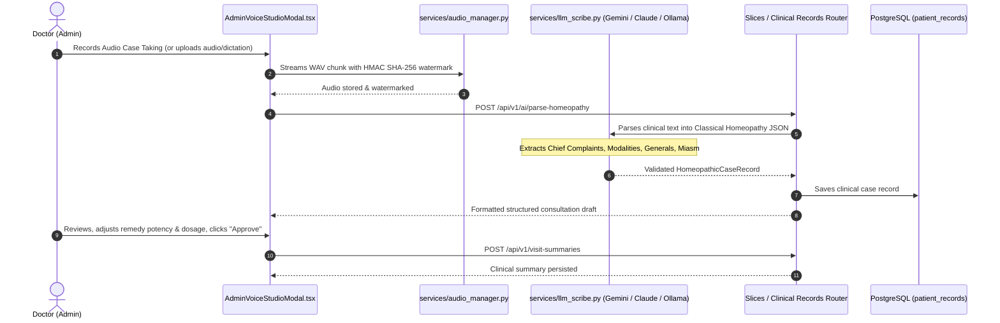

# System Wiring & End-to-End Data Flow

This document details the exact communication paths between user interface elements, state reducers, API services, FastAPI routers, and database tables.

---

## 1. End-to-End Flow Diagrams

### Flow A: Patient Appointment Booking & Google Calendar Sync

```mermaid
sequenceDiagram
    autonumber
    actor Patient as Patient (Browser)
    participant UI as AppointmentsPage.tsx
    participant Ctx as AppContext (Reducer)
    participant API as api.ts (HTTP Client)
    participant Route as Slices / Scheduling Router
    participant Store as Data Store / PostgreSQL
    participant GCal as Google Calendar API
    participant Mail as Resend / Email Service

    Patient->>UI: Selects Date & Time Slot, enters contact info
    UI->>API: api.appointments.book(payload)
    API->>Route: POST /api/v1/book-appointment
    Note over Route: Locks slot atomically; checks DB unique constraint
    alt Slot is already booked
        Route-->>API: 409 Conflict ("Time slot already booked")
        API-->>UI: Displays conflict banner with next available slot
    else Slot is free
        Route->>Store: Inserts appointment record (Status: "Confirmed")
        Route->>GCal: create_google_calendar_event()
        Route->>Mail: send_appointment_confirmation()
        Route-->>API: 201 Created (Appointment + Calendar payload)
        API-->>UI: Success response
        UI->>Ctx: dispatch({ type: "BOOK_APPOINTMENT", payload })
        Ctx-->>Patient: Instant UI update with appointment card & confirmation
    end
```

---

### Flow B: Doctor Consultation, Audio Watermarking & AI Scribe Parsing



---

## 2. API Routing & Vertical Slice Directory Map

| User Action / UI Component | Frontend Service (`src/services/api.ts`) | FastAPI Endpoint | Backend Slice | Persistence Target |
| :--- | :--- | :--- | :--- | :--- |
| **Login with Password / OTP** | `api.auth.login()` | `POST /api/v1/auth/login` | `slices/auth/router.py` | `clinic_users` table |
| **Verify OTP** | `api.auth.verifyOtp()` | `POST /api/v1/auth/verify-otp` | `slices/auth/router.py` | `otp_verifications` |
| **Google Sign-In** | `api.auth.google()` | Frontend OAuth Callback | `slices/auth/router.py` | Local JWT session |
| **Book Appointment** | `api.appointments.book()` | `POST /api/v1/book-appointment` | `slices/scheduling/router.py` | `appointments` table |
| **List Appointments** | `api.appointments.list()` | `GET /api/v1/appointments` | `slices/scheduling/router.py` | `appointments` table |
| **Public Holidays** | `api.appointments.getHolidays()` | `GET /api/v1/calendar/holidays` | `slices/scheduling/router.py` | Google Calendar / Cache |
| **Doctor Blocked Days** | `api.appointments.getBlockedDates()` | `GET /api/v1/blocked-dates` | `slices/scheduling/router.py` | `doctor_blocked_dates` |
| **AI Scribe Case Parsing** | `api.clinical.parseHomeopathy()` | `POST /api/v1/ai/parse-homeopathy` | `slices/clinical_records/router.py` | `patient_records` |
| **Prescription Photo OCR** | `api.clinical.uploadPrescription()` | `POST /api/v1/patients/{id}/upload-prescription` | `slices/clinical_records/router.py` | `uploaded_file_hashes` |
| **JEV Probabilistic Repertory** | `api.clinical.jevRepertorize()` | `POST /api/v1/ai/jev-repertorize` | `slices/clinical_records/router.py` | In-memory repertory model |
| **Dispensary Stock** | `api.inventory.list()` | `GET /api/v1/inventory` | `slices/dispensary/router.py` | `inventory` table |
| **Restock Medicine** | `api.inventory.restock()` | `POST /api/v1/inventory/{id}/restock` | `slices/dispensary/router.py` | `inventory` table |
| **List Invoices** | `api.billing.listInvoices()` | `GET /api/v1/consultation-invoices` | `slices/billing/router.py` | `consultation_invoices` |
| **Submit Invoice Payment** | `api.billing.updateInvoice()` | `PUT /api/v1/consultation-invoices/{id}` | `slices/billing/router.py` | `consultation_invoices` |
| **Create Pharmacy Order** | `api.orders.create()` | `POST /api/v1/orders/create` | `slices/billing/router.py` | `orders_sync.json` |
| **WhatsApp Notification** | `api.whatsapp.sendMessage()` | `POST /api/v1/whatsapp/send-message` | `slices/communications/router.py` | Meta Cloud API / Mock |
| **Resend Email Confirmation** | `api.email.send()` | `POST /api/v1/email/send` | `slices/communications/router.py` | Resend API / Mock |

