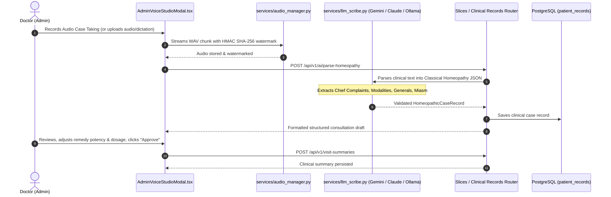

# System Wiring & End-to-End Data Flow

This document details the exact communication paths between user interface elements, state reducers, API services, FastAPI routers, and database tables.

---

## 1. End-to-End Flow Diagrams

### Flow A: Patient Appointment Booking & Google Calendar Sync

```mermaid
sequenceDiagram
    autonumber
    actor Patient as Patient (Browser)
    participant UI as AppointmentsPage.tsx
    participant Ctx as AppContext (Reducer)
    participant API as api.ts (HTTP Client)
    participant Route as Slices / Scheduling Router
    participant Store as Data Store / PostgreSQL
    participant GCal as Google Calendar API
    participant Mail as Resend / Email Service

    Patient->>UI: Selects Date & Time Slot, enters contact info
    UI->>API: api.appointments.book(payload)
    API->>Route: POST /api/v1/book-appointment
    Note over Route: Locks slot atomically; checks DB unique constraint
    alt Slot is already booked
        Route-->>API: 409 Conflict ("Time slot already booked")
        API-->>UI: Displays conflict banner with next available slot
    else Slot is free
        Route->>Store: Inserts appointment record (Status: "Confirmed")
        Route->>GCal: create_google_calendar_event()
        Route->>Mail: send_appointment_confirmation()
        Route-->>API: 201 Created (Appointment + Calendar payload)
        API-->>UI: Success response
        UI->>Ctx: dispatch({ type: "BOOK_APPOINTMENT", payload })
        Ctx-->>Patient: Instant UI update with appointment card & confirmation
    end
```

---

### Flow B: Doctor Consultation, Audio Watermarking & AI Scribe Parsing



---

### Flow C: Super Admin Hospital Provisioning & Doctor Onboarding

```mermaid
sequenceDiagram
    autonumber
    actor Super as Super Admin
    actor Admin as Clinic Director (Admin)
    participant UI as AdminDashboard.tsx
    participant API as api.ts (HTTP Client)
    participant HospRoute as routes/hospital.py
    participant AuthRoute as routes/auth.py
    participant Datastore as Dynamic Datastores (backend/data/)

    Super->>UI: Enters new clinic details (Name, Domain, Address, Logo)
    UI->>API: api.createHospital(payload)
    API->>HospRoute: POST /api/v1/hospitals
    Note over HospRoute: Validates caller has super_admin role; checks MAX_ADMINS limit
    HospRoute->>Datastore: Appends hospital to hospitals.json / database
    HospRoute-->>UI: 201 Created (New Hospital Tenant)

    Admin->>UI: Provisions Doctor under Clinic
    UI->>API: api.createDoctor(payload)
    API->>HospRoute: POST /api/v1/doctors
    Note over HospRoute: Validates caller has admin/super_admin role
    HospRoute->>Datastore: Appends doctor to doctors.json
    HospRoute-->>UI: 201 Created (Doctor Profile)

    Admin->>UI: Sends Customer / Doctor Invite
    UI->>API: api.invite(payload)
    API->>AuthRoute: POST /api/v1/auth/invite
    AuthRoute->>Datastore: Persists invite token to user_invites.json
    AuthRoute-->>UI: 200 OK (Invite Link: /join?token=...)
```

---

### Flow D: Customer Invite Acceptance & Tenant Scoped Self-Registration

```mermaid
sequenceDiagram
    autonumber
    actor User as Invited Customer / Guest
    participant Browser as Browser (/join?token=...)
    participant API as api.ts (HTTP Client)
    participant AuthRoute as routes/auth.py
    participant DB as clinic_accounts.json / Database

    User->>Browser: Opens Invite Link
    Browser->>API: api.acceptInvite(token, password)
    API->>AuthRoute: POST /api/v1/auth/accept-invite
    Note over AuthRoute: Verifies token validity & expiration; validates hospital quota (max 1000)
    AuthRoute->>DB: Registers user account strictly scoped to hospital_id
    AuthRoute-->>Browser: 200 OK (JWT Access Token + Profile)
    Browser-->>User: Auto-logs in to the assigned Clinic Tenant Dashboard
```

---

## 2. API Routing & Architecture Directory Map

| User Action / UI Component | Frontend Service (`src/services/api.ts`) | FastAPI Endpoint | Backend Router & Service | Persistence Target |
| :--- | :--- | :--- | :--- | :--- |
| **Login with Password / OTP** | `api.auth.login()` | `POST /api/v1/auth/login` | `routes/auth.py` (`services.auth_service`) | `clinic_accounts.json` / `clinic_users` |
| **Register Customer (Scoped)**| `api.auth.register()` | `POST /api/v1/auth/register` | `routes/auth.py` (`services.auth_service`) | `clinic_accounts.json` (max 1000/clinic) |
| **Send User Invite Link** | `api.invite()` | `POST /api/v1/auth/invite` | `routes/auth.py` (`services.auth_service`) | `backend/data/user_invites.json` |
| **Accept Invite Link** | `api.acceptInvite()` | `POST /api/v1/auth/accept-invite` | `routes/auth.py` (`services.auth_service`) | `clinic_accounts.json` / `clinic_users` |
| **Verify OTP** | `api.auth.verifyOtp()` | `POST /api/v1/auth/verify-otp` | `routes/auth.py` (`services.auth_service`) | In-memory OTP buffer |
| **Google Sign-In** | `api.auth.google()` | `POST /api/v1/auth/google` | `routes/auth.py` (`services.auth_service`) | Scoped local JWT session |
| **Provision Hospital (Super Admin)** | `api.createHospital()` | `POST /api/v1/hospitals` | `routes/hospital.py` (`services.hospital_service`) | `backend/data/hospitals.json` |
| **Provision Doctor (Admin)** | `api.createDoctor()` | `POST /api/v1/doctors` | `routes/hospital.py` (`services.doctor_service`) | `backend/data/doctors.json` |
| **Toggle Mock/Real Mode** | `api.toggleDevMode()` | `POST /api/v1/platform/toggle-dev-mode` | `routes/hospital.py` (`services.data_store`) | Runtime environment & mock sync |
| **Book Appointment** | `api.appointments.book()` | `POST /api/v1/book-appointment` | `routes/appointments.py` | `appointments` table / sync store |
| **List Appointments** | `api.appointments.list()` | `GET /api/v1/appointments` | `routes/appointments.py` | `appointments` table / sync store |
| **Public Holidays** | `api.appointments.getHolidays()` | `GET /api/v1/calendar/holidays` | `routes/appointments.py` (`services.calendar_service`) | Google Calendar / Cache |
| **Doctor Blocked Days** | `api.appointments.getBlockedDates()` | `GET /api/v1/blocked-dates` | `routes/appointments.py` | `doctor_blocked_dates` |
| **AI Scribe Case Parsing** | `api.clinical.parseHomeopathy()` | `POST /api/v1/ai/parse-homeopathy` | `routes/clinical.py` | `patient_records` |
| **Prescription Photo OCR** | `api.clinical.uploadPrescription()` | `POST /api/v1/patients/{id}/upload-prescription` | `routes/clinical.py` | `uploaded_file_hashes` |
| **JEV Probabilistic Repertory** | `api.clinical.jevRepertorize()` | `POST /api/v1/ai/jev-repertorize` | `routes/clinical.py` (`services.typesafe_jev_service`) | In-memory calibrated engine |
| **Dispensary Stock** | `api.inventory.list()` | `GET /api/v1/inventory` | `routes/dispensary.py` | `inventory` table |
| **Restock Medicine** | `api.inventory.restock()` | `POST /api/v1/inventory/{id}/restock` | `routes/dispensary.py` | `inventory` table |
| **List Invoices** | `api.billing.listInvoices()` | `GET /api/v1/consultation-invoices` | `routes/billing.py` | `consultation_invoices` |
| **Submit Invoice Payment** | `api.billing.updateInvoice()` | `PUT /api/v1/consultation-invoices/{id}` | `routes/billing.py` | `consultation_invoices` |
| **Create Pharmacy Order** | `api.orders.create()` | `POST /api/v1/orders/create` | `routes/billing.py` | `orders_sync.json` |
| **WhatsApp Notification** | `api.whatsapp.sendMessage()` | `POST /api/v1/whatsapp/send-message` | `services/notification_service.py` | Meta Cloud API / Mock |
| **Resend Email Confirmation** | `api.email.send()` | `POST /api/v1/email/send` | `services/email_service.py` | Resend API / Mock |

